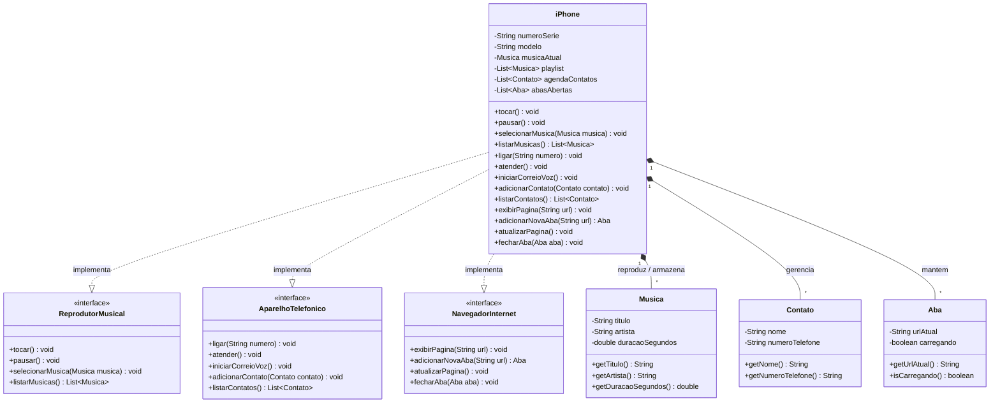

# Desafio: Modelagem e Diagramação da POO do iPhone (2007)

Este repositório contém a modelagem orientada a objetos e diagrama UML do revolucionário lançamento do **iPhone original (2007)**, baseada no desafio da trilha **Java Básico da Digital Innovation One (DIO)** e na icônica apresentação de **Steve Jobs** na Macworld 2007.

---

## 📱 Contexto do Desafio

Em 9 de janeiro de 2007, Steve Jobs subiu ao palco para apresentar um produto que mudaria a história da tecnologia móvel. O anúncio começou com uma premissa marcante: a Apple estava lançando não três dispositivos separados, mas **um único aparelho revolucionário** que unificava três papéis fundamentais:

1. **Um iPod com controles sensíveis ao toque** (*Reprodutor Musical*)
2. **Um telefone celular revolucionário** (*Aparelho Telefônico*)
3. **Um comunicador de Internet inovador** (*Navegador na Internet*)

> *"An iPod, a phone, and an internet communicator... these are not three separate devices, this is one device, and we are calling it iPhone."*  
> — [Steve Jobs no lançamento do iPhone (2007)](https://www.youtube.com/watch?v=VQKMoT-6XSg)

### Objetivo Técnico
Aplicar os pilares da **Programação Orientada a Objetos (POO)** em Java — especialmente **Abstração**, **Encapsulamento**, **Interfaces (Polimorfismo)** e **Composição** — para modelar os comportamentos e entidades do iPhone sem acoplamento indevido ou heranças incorretas.

---

## 📐 Diagrama de Classes UML (Domínio Expandido)

A modelagem a seguir foi concebida na sintaxe **Mermaid**. Além dos métodos essenciais do desafio, o domínio foi expandido para incluir entidades de dados ricas (`Musica`, `Contato` e `Aba`), associadas ao `iPhone` por **composição/agregação**:

---

## 🛠️ Decisões de Arquitetura e Modelagem

1. **Uso de Interfaces para Comportamentos Multitarefa:**
   * O `iPhone` implementa três interfaces independentes (`ReprodutorMusical`, `AparelhoTelefonico`, `NavegadorInternet`), respeitando o princípio de segregação de interfaces (ISP) do SOLID.
   * Interfaces definem *contratos de comportamento*, não retendo estado interno mutável.

2. **Composição em vez de Herança Indevida:**
   * Entidades como `Contato`, `Musica` e `Aba` representam dados e conceitos do domínio.
   * Em vez de tentar fazê-las herdar de interfaces ou de ações, elas são conectadas ao `iPhone` via **composição** (`*--`), indicando que um iPhone gerencia uma lista de contatos, uma biblioteca de músicas e abas de navegação.

3. **Tipagem e Boas Práticas:**
   * **Números de telefone:** Modelados como `String` para preservar zeros à esquerda (ex.: códigos DDD), caracteres especiais (`+`) e evitar overflow numérico.
   * **Verbos vs. Classes:** Ações como `tocar`, `pausar` e `ligar` são métodos das interfaces e classes concretas, mantendo as classes focadas em representar entidades.
